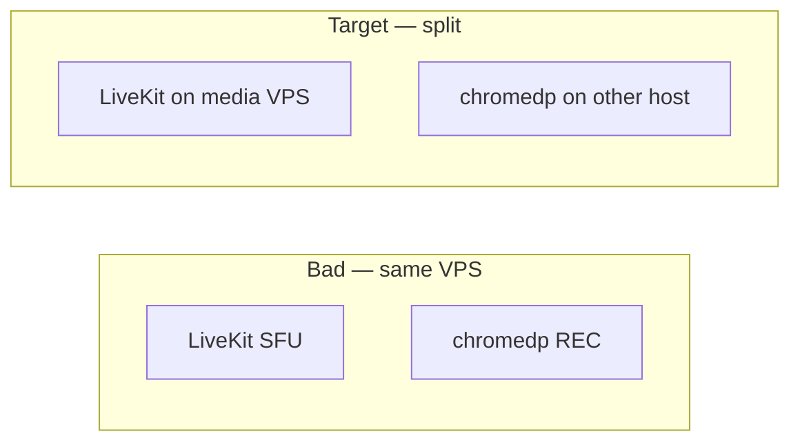

# UltaHost interim SFU — reconnect / mic-cam flip (20 Nov 2026)

**Status:** Demo Partial ops + client mitigations — not Live CAP-26.  
**Host:** UltaHost Singapore VPS `38.127.216.221` · k3s node `srv113287766` (4 vCPU / ~8 GiB).  
**Stack:** `/opt/raisd-classroom` · `docker-compose.ultahost.yaml` (LiveKit + plugNmeet + NATS + Redis + Caddy `:18480`).  
**Anchors:** [classrooms.md](../../backend/classrooms.md) · [ultahost-vps-self-defence.md](../ultahost-vps-self-defence.md) · [2026-11-18 capacity audit](./2026-11-18-class-connection-capacity.md) · [classroom-media-bridge.md](../classroom-media-bridge.md).

---

## Verdict

| Question | Answer |
|---|---|
| What was the mid-class failure? | LiveKit **local connection quality LOST → full reconnect** every ~17s (`CLIENT_REQUEST_LEAVE`, `Reconnect: false`, `RR_UNKNOWN` on restart join) |
| Why did mic/cam “turn off”? | Each full leave **unpublishes** tracks; footer shows off until republish (~2–3s later) — not `muteOnStart` |
| Was it Docker CPU/RAM **limits** on LiveKit? | **No** — containers had no caps; LiveKit idle ~30–70 MiB / &lt;1% CPU |
| Was anything server-side? | **Yes, host contention** — shared 4 vCPU with k3s (~11%), Jenkins, portals; hypervisor **steal** ~1–4%; chromedp recorder previously ~180% CPU made it worse |
| Cloud REC on this VPS? | **Deferred** — co-located recorder + SFU fights the host session |

**Diagram (SFU vs chromedp):** https://docs.raisd.co/diagrams/classroom-sfu-recorder/ — “not co-located” means LiveKit (live class) and the chromedp cloud-REC bot must not share the same small VPS.



---

## Symptoms (Demo classroom)

1. Toast **“Connection interrupted. Reconnecting…”** on a loop.  
2. Microphone / camera flip off (and sometimes back on) after Join.  
3. LiveKit logs: publish audio/video → ~13–15s later `CLIENT_REQUEST_LEAVE` → new session ~2s later with same identity.  
4. With chromedp recorder up: “No recorder is available” / recording error + higher steal/iowait.

---

## Root cause chain

```text
VPS steal / host contention / LOST quality samples
        ↓
livekit-client scheduleLostQualityReconnect (10s)
        ↓
full restartConnection → CLIENT_REQUEST_LEAVE
        ↓
mic/cam unpublished → UI “off” → republish after rejoin
        ↓
toast media-server-disconnected-reconnecting (until suppressed)
```

Runtime prototype patching alone was insufficient when the browser kept a **cached** i18n chunk. LOST path must be neutered in the **served bundle** (and clients must load the new hashes).

---

## Updates applied (20 Nov 2026 evening)

### A. Client (`plugnmeet-client` → `/opt/raisd-classroom/client/dist`)

| Change | Detail |
|---|---|
| LOST reconnect neutered | `scheduleLostQualityReconnect(){return}` + LOST call site clears timeout only; postbuild `scripts/neuter-lost-quality-reconnect.mjs` |
| Toast suppressed | `RoomEvent.Reconnecting` no longer shows “Connection interrupted…” on this edge |
| AdaptiveMedia off | `config.js` `enableAdaptiveMedia: false`, `enableDynacast: false`, `enableSimulcast: false` |
| Mic re-publish | Footer re-attempts publish on `Connected` / `Reconnected` |
| Cache bust | Served `main-module.CMx_ePNo.js` + `i18n.YwCQ0-md.js`; HTML `Cache-Control: no-store` + `Clear-Site-Data: cache` for documents; `config.js?v=lostguard1` fetch guard |
| Recorder join | Prefer local `http://127.0.0.1:18480` (not DIV Tailscale hairpin) when bot runs on UltaHost |

### B. Edge / compose (`docker-compose.ultahost.yaml` · `Caddyfile.ultahost`)

| Change | Detail |
|---|---|
| LiveKit priority | `cpu_shares: 2048`, `mem_reservation: 1g`, `shm_size: 512mb`, `oom_score_adj: -500`, process `nice -10` |
| plugNmeet / NATS | Higher `cpu_shares` + memory reservations |
| Caddy `:18480` | Document `Cache-Control: no-store` + `Clear-Site-Data: cache` (not on `/ws` `/rtc` `/livekit` `/assets/*`) |
| Recorder | Kept **stopped** for Demo host stability on this box |
| Jenkins | Scaled `jenkins/jenkins` deploy to **0** during class proof (restore after) |

### C. Lecturer portal (prior same day)

Lobby **15s / 3s Past Class polls skipped while `mediaOpen`** so refresh does not remount the Classroom iframe mid-session.

---

## Capacity note (compose “increase CPU/RAM”)

Raising Docker **limits** does not help when limits were already unlimited. Useful server actions on this shared VPS:

1. **cpu_shares / mem_reservation / nice** for LiveKit (done).  
2. **Stop Jenkins / recorder** during live proof (done for Demo window).  
3. **Larger UltaHost plan** or **dedicated media VPS** for real headroom + UDP TURN (still required for public students — see capacity audit).

---

## Operator checklist

1. Confirm recorder is down: `docker compose -f /opt/raisd-classroom/docker-compose.ultahost.yaml ps recorder`.  
2. Confirm served hashes: `curl -sS https://classrooms.raisd.co/ \| grep -oE 'main-module\.[^"]+|i18n\.[^"]+'`.  
3. Host must **close classroom modal / tab and Open again** after a client deploy (in-memory JS keeps the old LOST loop).  
4. Watch leaves: `docker compose … logs --since 2m livekit \| grep CLIENT_REQUEST_LEAVE`.  
5. Restore Jenkins after the Demo: `kubectl -n jenkins scale deploy/jenkins --replicas=1`.

---

## Open / still true

| Item | Status |
|---|---|
| Public UDP TURN / dedicated media VPS | Still required for reliable public student ICE |
| Cloud REC on interim UltaHost SFU | Not viable with chromedp on same 4 vCPU box |
| Durable compose file in git | Applied on VPS `/opt/raisd-classroom`; keep in sync when media bridge lands |
| Stale browser tabs | Always force full reopen after client cache-bust |
