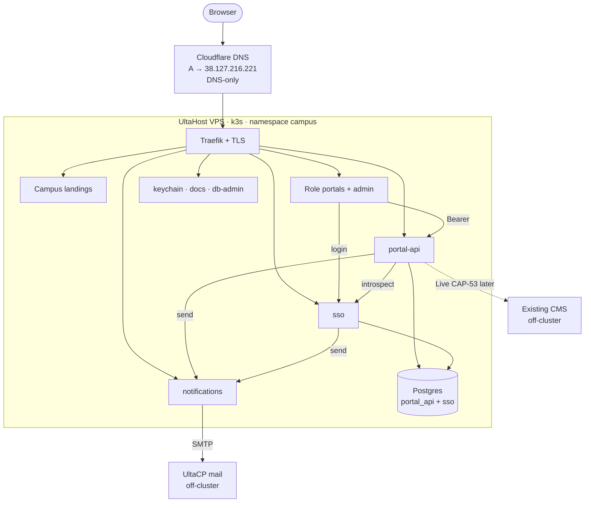

# VPS infrastructure topology (current Demo)

**Status:** As deployed — 16 October 2026 (Control + Campus Admin rename).  
**Canonical product stages:** [SDD-12](../../sdd/12-deployment-architecture.md) (ADR-2 UltaHost Singapore, ADR-3 k3s).  
**Published diagram:** [`docs/diagrams/architecture.html#vps`](../../diagrams/architecture.html#vps) · services [`#services`](../../diagrams/architecture.html#services).  
**Service catalogue:** [microservices.md](microservices.md).  
**Campus catalogue:** [demo-campuses.yaml](demo-campuses.yaml).

This is the **running Demo** topology on the UltaHost VPS. It does not replace the staged Live growth plan in SDD-12; it records what operators and agents should treat as production Demo today.

## 1. At a glance

```text
Browser
   │
   ▼
Cloudflare DNS (raisd.co) — A → 38.127.216.221 · DNS-only (grey cloud)
   │
   ▼
UltaHost VPS · Singapore · 38.127.216.221 · k3s
   │
   ├── Traefik · Let's Encrypt (cert-manager)
   │     ├── {slug}.raisd.co → campus-landing
   │     ├── apply|student|staff.{slug}.raisd.co → role portals
   │     ├── teach.{slug}.raisd.co → 308 → staff.{slug}.raisd.co (legacy)
   │     ├── admin.{slug}.raisd.co → 308 → staff.{slug}.raisd.co/admin (legacy)
   │     ├── api.raisd.co · api.{slug}.raisd.co → portal-api
   │     ├── sso.raisd.co → sso · notify.raisd.co → notifications
   │     ├── control.raisd.co · keychain.raisd.co · docs.raisd.co · db-admin.raisd.co
   │     ├── admin.raisd.co → 308 → control.raisd.co (legacy global)
   │     └── jenkins.raisd.co · argocd.raisd.co
   │
   ├── Microservices: portal-api · sso · notifications  (+ SPA Deployments)
   ├── StatefulSet postgres (portal_api + sso DBs)
   │
   └── Existing campus CMS + UltaCP mail  (off-cluster)
```

| Layer | Choice |
|---|---|
| Region | Singapore (ADR-2) |
| Compute | Single UltaHost VPS, IPv4 `38.127.216.221` |
| Runtime | k3s, namespace `campus` (ADR-3) |
| Ingress | Traefik (k3s) + cert-manager `letsencrypt-prod` |
| DNS | Cloudflare zone `raisd.co`, **DNS-only** A records → VPS |
| Database | Postgres 18 StatefulSet on the VPS (`portal_api`) |
| Static portals | Nginx / hostPath sync under `/var/www/portals/{applicant,student,admin,teach,control,keychain,docs,…}` |
| Identity of campus | Hostname → `campusId` lock (no cross-campus picker on scoped hosts) |

## 2. Request path



Rules (unchanged from SDD-02 / SDD-12; detail in [microservices.md](microservices.md)):

1. Portals never open Postgres or the CMS. They call SSO and Portal API only.
2. `api.{slug}.raisd.co` is the same Portal API service as `api.raisd.co` — campus scope is in the request / hostname lock, not a separate database per Demo campus today.
3. CMS and mail stay off Kubernetes.

## 3. Hostnames

### Shared (not campus-pinned)

| Host | Serves |
|---|---|
| `api.raisd.co` | Portal API (global) |
| `sso.raisd.co` | SSO identity + RBAC (login UI + `/v1/*`) |
| `control.raisd.co` | Control — super-admin SSO people / full RBAC |
| `admin.raisd.co` | Legacy alias — **308 →** `control.raisd.co` |
| `notify.raisd.co` | Notifications API (outbound email via `mail.raisd.co`) |
| `argocd.raisd.co` | Argo CD UI (GitOps sync) |
| `jenkins.raisd.co` | Jenkins CI — deploy trigger on push to **main** only ([cicd.md](cicd.md)) |
| `keychain.raisd.co` | Demo Keychain |
| `docs.raisd.co` | Documentation + OpenAPI UI (site gate + Sign out) |
| `db-admin.raisd.co` | Read-only DB admin (team) |
| `mail.raisd.co` | UltaCP mail (SMTP/IMAP) — **not** on the VPS; DNS-only A → mail host |

### Per Demo campus

For each slug in [demo-campuses.yaml](demo-campuses.yaml) (`lesotho`, `cyberjaya`, `botswana`, `eswatini`, `sierra-leone`, `cambodia`, `uganda`, `namibia`):

| Role | Hostname |
|---|---|
| Landing | `{slug}.raisd.co` |
| Applicant | `apply.{slug}.raisd.co` |
| Student | `student.{slug}.raisd.co` |
| Staff portal | `staff.{slug}.raisd.co` — Staff/Lecturer menus, or Admin menus at `/admin` when the active role is `admin` |
| API alias | `api.{slug}.raisd.co` |
| Teach (legacy) | `teach.{slug}.raisd.co` → **308 →** `staff.{slug}.raisd.co` |
| Admin (legacy) | `admin.{slug}.raisd.co` → **308 →** `staff.{slug}.raisd.co/admin` |

**Lesotho** is the pilot / M4 acceptance campus. Public endpoint catalogue: [`diagrams/index.html#endpoints`](../../diagrams/index.html#endpoints).

Live flat names in SDD-12 (`apply.raisd.co`, `student.raisd.co`, …) remain the **Live** target shape; Demo today uses the campus-scoped pattern above.

## 4. Workloads on the node

| Workload | How it runs | Notes |
|---|---|---|
| `portal-api` | Argo Application · hostPath Node (→ GHCR) | Fastify; CORS allowlist includes all campus origins |
| `sso` | Argo · GHCR `ghcr.io/raisd-campus/sso:main` | Fastify; DB `sso`; [../backend/sso.md](../backend/sso.md) |
| `notifications` | Argo · GHCR `ghcr.io/raisd-campus/notifications:main` | SMTP → `mail.raisd.co`; [../backend/notifications.md](../backend/notifications.md) |
| `postgres` | StatefulSet | Demo DBs `portal_api` + `sso` |
| Role portals + admin + landing | Argo Applications · hostPath nginx | Hostname pins `campusId` |
| `keychain` | Argo · GHCR | Demo login launcher |
| `docs` / `db-admin` | Argo · hostPath | Shared ops / docs |
| Jenkins / Argo CD | Namespaces `jenkins` / `argocd` | CI + GitOps UIs |
| Ingress `campus-multi` | Owned by Argo app `portal-static` | Multi-SAN cert for campus hosts |

Full table: [microservices.md](microservices.md).

## 5. Operator pointers

| Need | Where |
|---|---|
| DNS / host expansion | `scripts/cloudflare-dns.sh`, `scripts/campus-hosts.cjs` |
| Ingress / TLS | `scripts/k3s/campus-multi-ingress.yaml` |
| Stack URLs | `scripts/stack-config.cjs` |
| Agent hosting summary | [deployment.md](deployment.md) |
| Portal API runtime detail | [../backend/portal-api-deployment.md](../backend/portal-api-deployment.md) |
| **Argo CD / GitOps (preferred)** | [argocd.md](argocd.md) · `gitops/` — day-to-day deploys without SSH rsync |
| SSH recovery (console) | `gitops/bootstrap/recover-sshd.sh` (opens port **2222** as well as 22) |

`scripts/deploy-vps.sh` remains the fallback for static hostPath portals until each SPA has a GHCR image. Services (`sso`, `notifications`) move to Argo + GHCR first.

Do not commit `.env`, kubeconfigs, or live student data.
