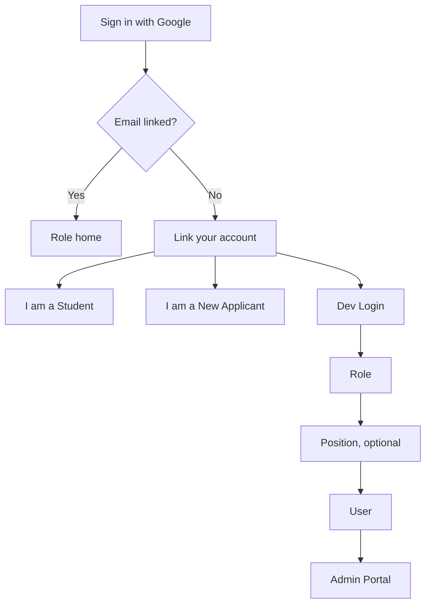
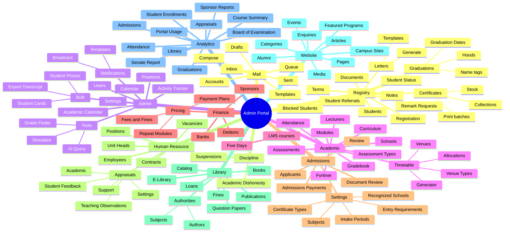

# Lesotho newer CMS — walkthrough, manual, and Raisd gap

**Campus:** Limkokwing University of Creative Technology — Lesotho.  
**Product:** staging Admin portal (dark UI, `DEBUG` ribbon). Host used for this walk: `https://luct.vercel.app`.  
**Walked:** 23 October 2026, signed in as a campus **Admin** whose position is **Registry Manager**. Active term on the dashboard: **2026-07**.  
**This file:** user manual and gap analysis for that portal. It does not copy student or staff records.  
**Published:** [mind map](https://docs.raisd.co/diagrams/old-cms-lesotho/newer-cms.html) · [Obsidian 3D](https://docs.raisd.co/diagrams/old-cms/obsidian.html?campus=lesotho) · [user manual](https://docs.raisd.co/diagrams/old-cms-lesotho/newer-cms-manual.html) · [gap vs Raisd](https://docs.raisd.co/diagrams/old-cms-lesotho/newer-cms-gap.html) · [workflow & control (Faid)](https://docs.raisd.co/diagrams/old-cms-lesotho/workflow-control-improvements.html) · [screenshots](../../diagrams/old-cms-lesotho/newer-cms-screenshots.html) (278 Admin screens, 23–26 Oct 2026) · [exports](../../diagrams/old-cms-lesotho/newer-cms-exports.html) (seven downloads, 26 Oct 2026).  
**Older inventories:** screenshot seed [old-cms-lesotho.md](old-cms-lesotho.md) (3 and 5 Oct 2026). Structure of the **old** LUCT CMS remains [lesotho-db-gap.md](lesotho-db-gap.md). Pilot framing: [lesotho-pilot.md](../architecture/lesotho-pilot.md).

This portal is the campus feature benchmark (ADR-1). It is **not** the Raisd system of record. Raisd portals still go through the Portal API. Nothing in this file is Raisd Live.

## Evidence boundary

| Observed this session | Not in this file |
|---|---|
| Menu, routes, tabs, filters, statuses, aggregate counts, fee names and LSL amounts on screen | Names, emails, student numbers, marks, documents, session tokens, passwords |
| Admin shell after Dev Login | Student portal and applicant wizard (not opened). Those journeys stay on the 3 Oct screenshot inventory |
| One student file, one registration request, the review queue, document-type chips, Fees & Fines, one position | Every leaf screen. Routes that were not opened are marked **not opened** |

The internal system admin account in Dev Login is **banned** and does not open the portal. Use a campus Admin account.

## Mind map

Sign-in, then the Admin Portal sidebar in menu order. A menu item is shown only when the signed-in user has that item’s **resource + action** (the action that reveals the item is `read`, except where a screen says otherwise).

### Legend

| Element | Meaning |
|---|---|
| Sign-in flowchart rectangles | Screens |
| Diamond | Linked-email decision |
| Admin Portal centre | Admin shell after sign-in |
| First ring | Sidebar groups (Registry → Mail) |
| Outer nodes | Menu items and nested desks |

Sidebar group colours match the Obsidian 3D graph: Registry, Discipline, Admin, Academic, Five Days, Finance, Admissions, Human Resource, Library, Website, Analytics, Mail.

## 1. Sign in

1. Open the staging host. The login page is Limkokwing University of Creative Technology, Lesotho. The only sign-in control is **Sign in with Google**. Assistance is **Contact Registry**.
2. Google may ask for a device prompt (this walk used the YouTube app on a phone).
3. If that Google email is not linked to a campus user, the next screen is **Link your account**. It shows the email and three ways forward:
   - **I am a Student**
   - **I am a New Applicant**
   - **Dev Login**, the orange control at the bottom right
4. Dev Login lists **Roles**, then optional **Positions**, then **Users**. Search narrows the user list. Choosing a user calls the dev login and continues into that user’s home.

### Roles in Dev Login (23 Oct 2026)

| Role | Users |
|---|---:|
| Finance | 6 |
| Registry | 3 |
| Library | 9 |
| Resource | 0 |
| Academic | 158 |
| Marketing | 6 |
| Student Services | 5 |
| Admin | 2 |
| Leap | 1 |
| Human Resource | 3 |
| IT | 4 |
| Quality Assurance | 3 |
| Registrar | 1 |
| Head of Institution | 1 |
| Student | 7,932 |
| Applicant | 4,585 |
| User | 4,242 |

Admin has two users. One is an internal system account and is banned. The campus Admin opens the Admin Portal. After sign-in the orange Dev Login control stays on the shell, so a permitted user can switch identity without returning to Google.

**Student account count (7,932) is not the student master (21,527).** They are different counters. This walk does not explain the difference.

## 2. Shell

| Control | What it does |
|---|---|
| Logo | Returns toward the portal home |
| Search | Read-only until opened. Hint **Ctrl+K** |
| Tasks | Opens the task list. The walk showed a badge of 5 |
| Notifications | Notification inbox |
| Theme | Light / dark |
| Account menu | Signed-in name and position |
| Term chip | Dashboard shows **Terms: 2026-07** |
| Dev Login | Switch role / position / user |

The empty dashboard title is **Admin Portal**. Work starts from the sidebar, not from dashboard widgets.

## 3. Registry

### Students — `/registry/students`

Master–detail. **21,527 records**, 1,436 pages. Search, **Filter Students**, and **New** (New was disabled for this Admin). Selecting a row opens the student file. Nothing is selected until a row is chosen.

Student file tabs:

| Tab | What it is for |
|---|---|
| Academics | Programme (status such as ACTIVE), term, year and semester, GPA, CGPA, **Print**, and the module grid |
| Student | Identity and programme profile |
| Registration | Term registration on this student |
| Attendance | Attendance for the student |
| Card | Campus card photo and preview |
| Graduation | Graduation record for the student |
| Finance | Student charges, payments, balance |
| Sponsors | Sponsor and borrower number (NMDS on this campus) |
| Education | Prior education |
| Documents | Documents filed on the student |
| Notes | Staff notes |
| Audit | Change history |

Academics module grid columns: **Code, Name, Status, Cr, Mk, Gd**. Status values seen include **Compulsory**. The grid is the statement-of-results source for this student. Print sits on this tab.

### Documents — `/registry/documents`

**Scanned student papers.** Separate from Admissions Document Review. Permission resource `documents`.

### Registration — `/registry/registration/requests`

**Registration Requests.** **3,835 records**, 256 pages. Master–detail.

Opened request tabs: **Details, Clearance, History**.

Details shows:

| Field | Notes |
|---|---|
| Student | Linked student |
| Date | Request timestamp |
| Semester | Year and semester label, for example Year 1 • Semester 2 |
| Term | Term code, for example 2026-07 |
| Status | **PENDING** on the request that was opened |
| Sponsor | Sponsor name, or none |
| Borrower No. | Sponsor borrower number when present |
| Modules | Count, then a table |

Module table columns: **Code, Name, Credits, Type, Status**. Type seen: **Compulsory**. Module status seen: **PENDING**.

Clearance on that request had no department rows, only a message field. History is the third tab. This is the staff queue for registration, not the student self-service screen.

A registration clearance route exists in the client (`/registry/registration/clearance`) and was **not opened**.

### Graduations

| Item | Route | Purpose |
|---|---|---|
| Graduation Dates | `/registry/graduations/dates` | Ceremony dates |
| Hoods | `/registry/graduations/hoods` | Hood catalogue |
| Name tags | `/registry/graduations/tags` | Name tags |

A clearance route exists (`/registry/graduations/clearance`) and was **not opened**. The 3 Oct screenshots still describe the multi-department clearance wizard (Academic / Finance, approve or reject, gown and fee message).

### Certificates

| Item | Route | Purpose |
|---|---|---|
| Print batches | `/registry/certificates/jobs` | Certificate print jobs |
| Collections | `/registry/certificates/collections` | Collection desk |
| Stock | `/registry/certificates/stock` | Certificate stock |

The group is visible when the user can read certificate jobs or certificate collections.

### Student Status — `/registry/student-statuses`

Status workflow for students. The 23 Oct sidebar showed a badge of **1**.

### Remark Requests — `/registry/remark-requests`

Re-assessment review. Sidebar badge **64** on this walk. Staff queue for remark / reassessment. Related fee name on Fees & Fines: **Re-assessment**, LSL 350.00 (see Finance).

### Student Referrals — `/registry/student-referrals`

Referrals, memos, and notifications.

### Notes — `/registry/student-notes`

Notes on students. Same idea as the Notes tab on the student file, as a cross-student desk.

### Letters

| Item | Route | Purpose |
|---|---|---|
| Letters | `/registry/letters/generate` | Generate a letter |
| Templates | `/registry/letters/templates` | Letter templates |

### Blocked Students — `/registry/blocked-students`

Students blocked from an action (the screen itself was **not opened**). Treat as a hold list until a later walk confirms the block reasons.

### Terms — `/registry/terms`

Term configuration. The dashboard term chip read **2026-07**.

## 4. Discipline

| Item | Route | Purpose |
|---|---|---|
| Academic Dishonesty | `/registry/academic-dishonesty` | Dishonesty cases |
| Suspensions | `/registry/suspensions` | Suspensions |

Both were **not opened**. They are registry-domain routes under a Discipline heading.

## 5. Admin

| Item | Route | Purpose |
|---|---|---|
| Calendar | `/admin/tasks` | Manage tasks. Same family as the header Tasks button |
| Academic Calendar | `/admin/academic-calendar` | Academic calendar |
| Users | `/admin/users` | Portal users |
| Positions | `/admin/user-positions` | Positions and permissions |
| Notification templates | `/admin/notifications/templates` | Notification templates |
| Broadcast | `/admin/notifications/broadcast` | Broadcast a notification |
| Activity Tracker | `/admin/activity-tracker` | Activity log |
| Settings | `/admin/settings` | Portal settings |

### Tools

| Item | Route | Purpose |
|---|---|---|
| Simulator | `/admin/tools/simulate` | Simulation tool. **Not opened** |
| Grade Finder | `/admin/tools/grade-finder` | Grade lookup. **Not opened** |
| AI Query | `/admin/tools/query` | Query assistant. **Not opened** |

### Bulk

| Item | Route | Purpose |
|---|---|---|
| Export Transcript | `/admin/bulk/transcripts` | Bulk transcript export |
| Student Cards | `/admin/bulk/student-cards` | Bulk card production |
| Student Photos | `/admin/bulk/student-photos` | Bulk photo handling. Menu permission uses students **update** |

### Positions — `/admin/user-positions`

**28 positions.** Search and a Role filter. **New** was disabled for this Admin. Page 1 showed:

| Position | Role |
|---|---|
| HOD Human Resource | Human Resource |
| IT HOD | IT |
| Library HOD | Library |
| Academic Manager | Academic |
| Student Services Staff | Student Services |
| Marketing HOD | Marketing |
| Marketing Staff | Marketing |
| Year Leader | Academic |
| IT Staff | IT |
| Head of Academic Quality Assurance | Quality Assurance |
| Head of Institution | Head of Institution |
| Registry HOD | Registry |
| Finance HOD | Finance |
| Lecturer | Academic |
| Academic Admin | Academic |

The other 13 positions were on later pages and were **not listed**.

Opening **Registry HOD** shows Name, Role (`REGISTRY`), Description, and **Permissions** grouped as Academic, Appraisals, Registry, Certificates, Admissions, Finance, Admin, Library, Reports, Settings. The sidebar itself is built from resource/action pairs. Resources declared on the menu include `students`, `documents`, `registration`, `graduation`, `certificate-jobs`, `certificate-collections`, `student-statuses`, `remark-requests`, `student-referrals`, `student-notes`, `letters`, `letter-templates`, `blocked-students`, `terms-settings`, `academic-dishonesty`, `suspensions`, `tasks`, `academic-calendar`, `users`, `user-positions`, `notification-settings`, `notification-broadcast`, `activity-tracker`, `prints`, `assigned-modules`, `assessments`, `assessment-types`, `attendance`, `gradebook`, `modules`, `schools`, `curriculum`, `sponsors`, `banks`, `debtors`, `pricing`, `payment-plans`, `admissions-review`, `applicants`, `admissions-payments`, `admissions-documents`, `intake-periods`, `certificate-types`, `subjects`, `recognized-schools`, `entry-requirements`, `employees`, `employee-contracts`, `employee-positions`, `employee-unit-heads`, `vacancies`, `staff-appraisals`, `teaching-observations`, `feedback-cycles`, `appraisal-periods`, `teaching-observation-criteria`, `staff-appraisal-review-chain`, `library`, `mails`, and the `website-*` and `reports-*` resources.

## 6. Academic

| Item | Route | Purpose |
|---|---|---|
| Lecturers | `/academic/assigned-modules` | Modules assigned to lecturers |
| Assessments | `/academic/assessments` | Assessment records |
| Assessment Types | `/academic/assessment-types` | Assessment type catalogue |
| Attendance | `/academic/attendance` | Attendance desk (class side, distinct from the student Attendance tab) |
| Gradebook | Menu item, no child links in the client menu | Gradebook. Special routes exist and were **not opened**: `/academic/gradebook/special/deferred`, `.../remark`, `.../supplementary` |
| Modules | `/academic/modules` | Module catalogue |
| Schools | `/registry/schools` | Schools (FICT and others) |
| Curriculum | `/registry/curriculum` | Programmes and curriculum. A review route `/registry/curriculum/review` exists and was **not opened** |
| FiveDays | `/lms/courses` | Learning Management System inside this portal. **Not opened** |
| Fortinet | `/plugins/fortinet` | Fortinet plugin. **Not opened** |

### Timetable

| Item | Route |
|---|---|
| Generator | `/timetable/generator` |
| Allocations | `/timetable/timetable-allocations` |
| Venues | `/timetable/venues` |
| Venue Types | `/timetable/venue-types` |

These four were **not opened**. The menu is the timetable desk: generate, allocate, and maintain venues.

Other academic routes present in the client and **not opened**: `/academic/academic-roles` and reporting paths under `/academic/reporting/` for lecturers, principal lecturers, program leaders, and year leaders.

## 7. Finance

| Item | Route | Purpose |
|---|---|---|
| Sponsors | `/finance/sponsors` | Sponsor master (NMDS and others) |
| Banks | `/finance/banks` | Bank list |
| Debtors | `/finance/debtors` | Debtor accounts |
| Repeat Modules | `/finance/pricing/repeat-modules` | Repeat-module pricing |
| Fees and Fines | `/finance/pricing/fees-and-fines` | Fee and fine catalogue |
| Payment Plans | `/finance/pricing/payment-plans` | Instalment plans |

Sponsors, banks, debtors, repeat modules, and payment plans were **not opened**.

### Fees & Fines — opened

Heading **Fees & Fines**. Action: **Configure rates**. Category chips: **All, Fines, Graduation, Registration, Student Card**.

Amounts on the All view during this walk (currency **LSL**). This is the staging catalogue on screen, not a Raisd fee decision:

| Name | Amount (LSL) |
|---|---:|
| AdmChg | 500.00 |
| Air Ticket | 350.00 |
| Certificates reprinting | 1,000.00 |
| Camera fines | 10.00 |
| IT fines | 250.00 |
| Interest surcharge / fine | 500.00 |
| Late Registration Fee | 450.00 |
| Late registration | 350.00 |
| Late / instalment interest | 35.00 |
| Library Fine | 100.00 |
| Misc Charges | 150.00 |
| Re-assessment | 350.00 |
| Recreational Fees | 1,000.00 |
| Resource Fees | 500.00 |
| Transcripts | 500.00 |

The list can continue below the first screen. Do not treat this table as the full tuition catalogue.

## 8. Admissions

| Item | Route | Purpose |
|---|---|---|
| Review | `/admissions/admissions-review` | Recommendation queue |
| Applicants | `/admissions/applicants` | Applicant master |
| Admissions Payments | `/admissions/payments` | Application payment verification |
| Document Review | `/admissions/documents` | Submitted document queue |
| Intake Periods | `/admissions/intake-periods` | Intakes |
| Certificate Types | `/admissions/certificate-types` | School-certificate types |
| Subjects | `/admissions/subjects` | School subjects used in extracts |
| Recognized Schools | `/admissions/recognized-schools` | Schools the campus accepts |
| Entry Requirements | `/admissions/entry-requirements` | Entry rules |

Applicants, payments, and the five settings screens were **not opened**. A hostel route `/admissions/hostel-applications` exists in the client and was **not opened**. It is not in the sidebar that was on screen.

### Review — opened

Search and **Filter**. Filter fields: **Pending, Approved, Rejected, Intake Period, School, Program**.

Each card shows rank, programme code, intake, score, and progress **n/3**. The intake on the cards in this queue was **January 2026**. Schools named in the by-school panel: **FBMG, FABE, FICT**.

The side panel is **Review Progress**: counts for **recommended**, **not recommended**, and **pending**, plus **Your Activity** (reviewed today versus the queue). For this Admin the queue was **4** applications (1 recommended, 2 not recommended, 1 pending). That is this user’s review queue, not the applicant population (4,585 applicant accounts in Dev Login).

Progress **n/3** matches the three-step recommendation chain seen on 3 Oct (Academic, QA, Registrar). This walk did not open a single application’s Review / Documents / History tabs.

### Document Review — opened

**4,066 records**, 272 pages. Search and **Filter Documents**. Document-type chips on the list include:

- ACADEMIC RECORD
- CERTIFICATE
- APPLICATION FORM
- IDENTITY
- PROOF OF_PAYMENT

A scanned script and extracted subject rows (including LGCSE and Sesotho) were described from the 3 Oct screenshots. This walk did not open a single document, so those extract fields are **not re-confirmed** here.

## 9. Human Resource and appraisals

| Item | Route | Purpose |
|---|---|---|
| Employees | `/human-resource/employees` | Employee master |
| Contracts | `/human-resource/contracts` | Contracts |
| Positions | `/human-resource/positions` | HR positions (distinct from Admin user positions) |
| Unit Heads | `/human-resource/unit-heads` | Unit heads |
| Vacancies | `/human-resource/vacancies` | Vacancies |

A profile-change route `/human-resource/profile-change` exists and was **not opened**.

### Appraisals

| Item | Route |
|---|---|
| Academic Appraisals | `/appraisals/staff-appraisals/academic` |
| Support Appraisals | `/appraisals/staff-appraisals/support` |
| Teaching Observations | `/appraisals/teaching-observations` |
| Student Feedback | `/appraisals/student-feedback` |
| Appraisal Periods | `/appraisals/settings/periods` |
| Student-feedback questions | `/appraisals/settings/student-feedback` |
| PRL observation questions | `/appraisals/settings/observation-criteria` |
| Academic appraisal questions | `/appraisals/settings/staff-appraisals/academic` |
| Support appraisal questions | `/appraisals/settings/staff-appraisals/support` |
| Academic review chain | `/appraisals/settings/staff-appraisals/academic/review-chain` |
| Support review chain | `/appraisals/settings/staff-appraisals/support/review-chain` |

None of the HR or appraisal screens were opened. The menu is enough to see that appraisals split academic staff from support staff, and that questions and review chains are configured separately from the appraisal runs.

## 10. Library

| Item | Route | Notes |
|---|---|---|
| Catalog | `/library/catalog` | |
| Loans | `/library/loans` | |
| Books | `/library/books` | |
| Fines | `/library/fines` | Overdue charges |
| E-Library | `/library/e-library` | |
| Publications | `/library/publications` | Research and journals |
| Question Papers | `/library/resources/question-papers` | Past exam papers |
| Authors | `/library/authors` | Under Authorities |
| Subjects | `/library/subjects` | Under Authorities |

Not opened. Library Fine on the finance catalogue was LSL 100.00.

## 11. Website

Public-site content for the campus, edited inside the same Admin portal.

| Item | Route |
|---|---|
| Pages | `/website/pages` |
| Articles | `/website/articles` |
| Categories | `/website/categories` |
| Featured Programs | `/website/featured-programs` |
| Enquiries | `/website/enquiries` |
| Campus Sites | `/website/campuses` |
| Alumni | `/website/alumni` |
| Media | `/website/media` |
| Events | `/website/events` |

Not opened. Unread-enquiry count is a server action in the client (`countUnreadEnquiries`).

## 12. Analytics

| Report | Route |
|---|---|
| Course Summary | `/reports/academic/course-summary` |
| Attendance | `/reports/academic/attendance` |
| Appraisals | `/reports/human-resource/appraisals` |
| Board of Examination | `/reports/academic/boe` |
| Senate Report | `/reports/academic/senate-report` |
| Student Enrollments | `/reports/registry/student-enrollments` |
| Graduations | `/reports/registry/graduations` |
| Admissions | `/reports/admissions` |
| Sponsor Reports | `/reports/finance/sponsors` |
| Portal Usage | `/reports/registry/portal-usage` |
| Library | `/reports/library` |

Not opened. Further registry report routes exist in the client (`/reports/registry/programs`, `/reports/registry/sponsors`) and were not in the sidebar list above.

## 13. Mail

| Item | Route |
|---|---|
| Compose | `/mail/compose` |
| Inbox | `/mail/inbox` |
| Accounts | `/mail/accounts` |
| Templates | `/mail/templates` |
| Drafts | `/mail/send` |
| Sent | `/mail/sent` |
| Queue | `/mail/queue` |

Not opened. Drafts is the menu label; the route in the client is `/mail/send`. This is in-portal mail, separate from Raisd outbound notifications.

## 14. Student and applicant

This Admin session did not open the student home or the applicant form.

An unlinked Google user can choose **I am a Student** or **I am a New Applicant** on Link your account. Client routes named from that screen are `/student-portal` and `/auth/student-link`. They were not followed.

The 3 Oct screenshot inventory ([old-cms-lesotho.md](old-cms-lesotho.md)) still describes the student home as programme, year/semester, Active, CGPA, and module count, with Registration, Curriculum, Finance, Assessments, Timetable, and Results. Treat that as the earlier UX seed, not as re-tested on 23 Oct.

## 15. Gap against the Raisd system under development

Raisd status below is the knowledge base as of this file, not a new test of `*.lesotho.raisd.co`. **Live is not claimed** for any row. Demo means sample or session behaviour through the Portal API. Staff Admin today is the Admin menu on the staff portal (`staff.lesotho.raisd.co/admin`): applicants, students, payments, registrations, and access presets. Control (`control.raisd.co`) owns custom roles. Applicant and Student sign-in is Raisd SSO.

| Newer CMS area | What the campus portal does | Raisd now | Gap for the Lesotho pilot |
|---|---|---|---|
| Sign-in | Google, then link as student or applicant, or Dev Login by role | Raisd SSO. Campus apex is login-only, then one portal or a picker | Different identity. No Google link flow. Dev Login is a staging switcher, closer to the Raisd Demo keychain than to Live SSO |
| Student master | 21,527 records and a 12-tab file | Student Demo profile. Staff has a student tracker, not this file | CAP-53 read adapter is mapped and not implemented. Staff cannot run the registry file |
| Academics / results | Term grid, GPA, CGPA, print | Student Demo results | Print, stamp, and QR statement of results are still a campus deliverable, not a Demo print product |
| Registration requests | 3,835 requests, module lines, sponsor, borrower number, clearance and history | Student Demo module registration. Staff registrations exist on the Portal API for the agreed clearance path | The request queue, per-module pending state, and borrower number on the request are not the staff UI |
| NMDS | Sponsor and borrower number on the student and on the registration request | Student Demo funding. Old CMS assist path is documented. No government HTTP API was found in the old dump | Campus funding must stay NMDS / assist, not Botswana DTEF |
| Admissions review | Rank, score, January 2026 intake, progress n/3, recommended / not recommended, by school | Applicant Demo plus a staff applicants queue and University Flows desks | Rank, score, and the three-step recommendation are still the M4 product hole |
| Document review | 4,066 items and the five document types above | CAP-03 not started as a staff extract desk | LGCSE extract, Sesotho, and certificate number stay unconfirmed this session and unimplemented in Raisd |
| Admissions settings | Intakes, certificate types, subjects, recognized schools, entry requirements | Campus policy is Demo defaults, not Lesotho Live policy | These catalogues are campus configuration Raisd does not yet edit per Lesotho |
| Fees and fines | LSL catalogue and Configure rates | Applicant shows LSL 300.00 as the admissions registration fee. Finance profile and dynamic fees are proposals | The fine and reprint catalogue is not Raisd configuration. Currency is LSL, not MYR |
| Payment plans, banks, debtors | Separate desks | Payments on staff Admin are verification, not this ledger | Bursary operations beyond proof approval are open |
| Graduation, hoods, certificates, stock | Full registry group | Student Demo graduation. No certificate print, hood, or stock desk | Multi-department clearance and certificate production are unmet |
| Remarks | Queue with a live badge, plus a re-assessment fee | Student Demo remark request. No staff queue | Staff reassessment desk is open |
| Positions | 28 named positions and grouped permissions | Control custom roles and four access presets (Applicant, Student, Staff, Lecturer) | Year Leader, Registry HOD, QA head, and the other campus positions are not 1:1 Raisd roles |
| Timetable generator | Generator, allocations, venues | Student Demo timetable. Lecturer classrooms are Demo | Generation and venue admin are unmet |
| Attendance | Student tab and academic desk | Student and lecturer Demo attendance | Staff-wide attendance admin is unmet |
| FiveDays and Fortinet | In-portal LMS route and a Fortinet plugin | Raisd LMS is a separate Demo/research surface. Not this product | Do not treat FiveDays tables as Raisd Live |
| HR, appraisals, library, website, mail, analytics | Full sidebar groups | Not in the Raisd portal set. Outbound email is the notifications service, not this mail client | Outside the admissions-and-student launch, unless the pilot acceptance list is widened |
| Discipline | Dishonesty and suspensions | Not in the Raisd admin menu | Unmet if the pilot must match discipline |
| Blocked students and letters | Hold list and letter templates | Not a Raisd desk | Unmet |

### What Raisd already covers in Demo, and still is not this CMS

- Applicant submission, evidence, offer, and accept, on SSO, with an LSL admissions fee presentation.
- Student registration, timetable, attendance, results, finance, graduation, funding, and remarks as Demo screens.
- Staff applicants, payments, registrations, and access presets on the staff portal.
- Campus landing at `lesotho.raisd.co`.

Those are the under-development surfaces. They are not equivalent to the desks in sections 3–13.

### Pilot cut, from this walk

If M4 acceptance is “at least the campus portal for admissions and the enrolled student”, the unmatched work that blocks that reading is:

1. Admissions review (n/3, rank, score, recommendation) and document review.
2. Registration request queue with clearance, sponsor, and borrower number.
3. Student file parity for academics, finance, sponsors, card, and graduation, including print.
4. LSL fee catalogue rather than a single admissions amount.
5. Position-level permissions for Registry, QA, Finance, and Academic, not only four presets.

HR, library, website, mail, appraisals, FiveDays, Fortinet, and the report pack are real menus. They are a wider parity list than the current Raisd milestone set.

## 16. Exports saved 26 Oct 2026

Seven downloads from the staging Admin. Pages list columns, ceremony totals, and report totals. Student names, student numbers, and certificate references that contain a student number are not copied.

| Download | Page |
|---|---|
| Graduation list, 17 September 2026, 1,047 students, two sessions | [graduation list](../../diagrams/old-cms-lesotho/newer-cms-export-graduation-list.html) |
| Name-tag PDF, 173 A4 pages, Pass or Merit | [name tags](../../diagrams/old-cms-lesotho/newer-cms-export-name-tags.html) |
| Certificate batch manifest, 9 rows, `first_issue` | [manifest](../../diagrams/old-cms-lesotho/newer-cms-export-certificate-manifest.html) |
| Certificate PDF, 9 pages, one graduate each, QR per page | [certificate batch](../../diagrams/old-cms-lesotho/newer-cms-export-certificate-batch.html) |
| Registration report, term 2026-07, 4,641 students | [registered students](../../diagrams/old-cms-lesotho/newer-cms-export-registered-students.html) |
| Registry Word enrollment summary, same 4,641 | [enrollment summary](../../diagrams/old-cms-lesotho/newer-cms-export-enrollment-summary.html) |
| Registry Word graduation summary, Graduation Date 2026-09, 35 graduates | [graduation summary](../../diagrams/old-cms-lesotho/newer-cms-export-graduation-summary.html) |

Index: [newer-cms-exports.html](../../diagrams/old-cms-lesotho/newer-cms-exports.html).

The ceremony list and the Analytics graduation summary are different reports. The list is 1,047 students on 17 September 2026. The summary for 2026-09 is 35 graduates, all Diploma in Architecture Technology. The name-tag PDF has 1,027 tickets (Pass 550, Merit 477), 20 short of the ceremony list.

Faculty labels also differ. The ceremony list and the certificate manifest keep Faculty of Communication and Media, Faculty of Film, Television & Broadcasting, Faculty of Design and Innovation, and Faculty of Fashion and Lifestyle Design. The 26 Oct registration report and the enrollment summary use Faculty of Communication, Media and Broadcasting and Faculty of Design.

Certificate references use `LSO` + a programme code + the student number. Codes on this batch: BEN, CMK, CITM, DTM, CGD, CPA, DBIT, DIT. The certificate spells entrepreneurship as Bachelor of Business in Entrepreneurship. The printed date on every certificate and every name tag is 17 September 2026. Signatures on the certificate template are the Vice Chancellor and the Registrar.

## Related

| Topic | Path |
|---|---|
| 26 Oct exports | [newer-cms-exports.html](../../diagrams/old-cms-lesotho/newer-cms-exports.html) |
| Pilot decision | [lesotho-pilot.md](../architecture/lesotho-pilot.md) |
| Screenshot inventory (3 Oct) | [old-cms-lesotho.md](old-cms-lesotho.md) |
| Old CMS structure and M4 gap | [lesotho-db-gap.md](lesotho-db-gap.md) |
| Applicant comparison | [lesotho-cms-vs-applicant-portal.md](lesotho-cms-vs-applicant-portal.md) |
| Workflow & control proposal (28 Oct) | [lesotho-workflow-control-improvements.md](lesotho-workflow-control-improvements.md) · [workflow-control-improvements.html](../../diagrams/old-cms-lesotho/workflow-control-improvements.html) |
| Raisd Admin desks | [admin-portal.md](../frontend/admin-portal.md) |
| Raisd Applicant | [applicant-portal.md](../frontend/applicant-portal.md) |
