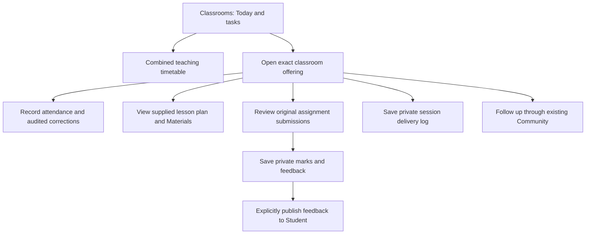

# Lecturer portal

**Document:** SDD-06  
**Status:** Working draft  
**Date:** 18 September 2026 (current source baseline updated 15 October 2026)
**Milestones:** Core teaching on [M3](03-delivery-milestones.md#m3); live class, quizzes, analytics on [M5](03-delivery-milestones.md#m5)

## 1. Purpose

UI refinement (unverified): Today contains today’s sessions only; All is a flat list of assigned offerings with enrolments, code above module name. No enrolment selector, programme headings, leading list icons, next-class card or selector footer buttons. Classrooms title sits in the selector column. Nonzero issues use shared IssueCards; selector scrolling uses shared hidden-scrollbar/fades. Attendance groups navigation by day with a conditional time-range session selector, student avatars and red Not recorded labels; informational banners/helper text are removed without relaxing read-only rules. Tests/builds remain deferred.

Give lecturers a day-to-day Classrooms workspace: timetable, attendance, submission review, private draft marks and published feedback, read-only lesson plans/Materials and student follow-up. Module/admin setup, content authoring, live teaching and advanced analytics remain deferred.

The previous Classrooms baseline was verified and activated in the local shared memory Demo; the attendance-first UI overhaul is unverified (tests/builds/browser verification deferred by owner). It introduces a Today / All selector beside Attendance / Assessments / Materials / Overview in shared TabbedPagePanels; narrow layouts use one panel at a time. Lesson plan and Students tabs are hidden, with data retained. Complete-roster Submit validation is UI-only until UI approval. API behavior and running services are unchanged; Lecturer aggregate verification remains held. Dashboard remains empty; Modules is reserved for future setup. Shared memory Demo is not Live or durable CMS storage. Historical milestone notes below retain prior evidence; the final current-source section and canonical Classrooms guide take precedence.

Attendance day-navigation increment (unverified, 15 October 2026): one date option
per scheduled day in the exact offering's campus time zone, with previous/next day
arrows. A shared session selector sits after the date and before Next only for
multiple sessions on that day, labelled with actual time ranges and Cancelled where
applicable. Defaults prefer current, started/unmarked, upcoming, then latest past;
explicit session links take precedence. Roster, draft, submission and separate audit
history stay scoped to that session. URL state preserves browser history. No API or
schema changes/restart; all tests/builds/browser verification remain owner-deferred.

Local Demo fixture (15 October 2026, unverified): Graphic Design 3 on 1 September
2026 has its existing 09:00–12:00 occurrence plus one explicit 14:00–16:00 session
for trying the same-day selector. Each retains independent attendance. API 8087 was
restarted to load it; testing remains deferred. See the canonical Classrooms guide.

Verification receipt (15 October 2026): the owner resumed all deferred Classrooms/
Materials checks. Isolated candidate Lecturer, Student full gate, shared component
and API/browser flows passed. The published 0.7.0 package still lacks AuditTrail;
release readiness remains separate. Current user services/data were preserved.
See [complete verification](../ai/frontend/student-portal/audits/2026-10-15-classrooms-materials-verification.md).

## 2. Actors

Lecturer. QA reviews materials ([CAP-43](11-capability-catalog.md#cap-43)). Faculty staff schedule classes ([CAP-11](11-capability-catalog.md#cap-11) staff). Examinations/QA own integrity policy ([CAP-29](11-capability-catalog.md#cap-29)).

## 3. Primary flows

Campus-requested lecturer work: timetable/attendance, content publishing, assessment review/marking/integrity.

## 4. Capabilities

### [M3](03-delivery-milestones.md#m3) — required to make student learning Live

| ID | Feature | Frontend | Design notes |
|---|---|---|---|
| [CAP-44](11-capability-catalog.md#cap-44) | Lecturer workspace and course access | Verified local Demo | Today/Timetable/All classrooms and exact classroom tabs; Dashboard stays empty. Confirm old CMS equivalence before Live. |
| [CAP-11](11-capability-catalog.md#cap-11) | View teaching timetable and allocations | Verified local Demo | Canonical assigned sessions; same schedule source as Student. |
| [CAP-12](11-capability-catalog.md#cap-12) | Record and correct attendance | Verified local Demo | Shared memory Present/Absent and audited corrections; Student is read-only. |
| [CAP-17](11-capability-catalog.md#cap-17) | Publish study guides | Not started | Version, release date, authorised audience. |
| [CAP-18](11-capability-catalog.md#cap-18) | Publish lecture notes and media | Partial (Demo) | Existing direct materials desk publishes metadata; real bytes and authorised student download remain pending. |
| [CAP-19](11-capability-catalog.md#cap-19) | Publish assignment briefs and deadlines | Partial (Demo) | Existing direct materials desk publishes synthetic brief metadata; real brief delivery remains pending. Brief file is the contract for [CAP-20](11-capability-catalog.md#cap-20). |
| [CAP-21](11-capability-catalog.md#cap-21) | Publish revision / practice | Not started | Campus requested. |
| [CAP-22](11-capability-catalog.md#cap-22) | Prepare past papers for authorised publication | Not started | Faculty/exams approve access (staff [CAP-22](11-capability-catalog.md#cap-22)). |
| [CAP-23](11-capability-catalog.md#cap-23) | Maintain course information and outcomes | Not started | Structured outcomes, not only a module blurb. |
| [CAP-43](11-capability-catalog.md#cap-43) | Submit course materials for quality review | Not started | QA counterpart in staff portal. |
| [CAP-20](11-capability-catalog.md#cap-20) | Receive and review submitted assignments | Verified local Demo | Version-bound original PDF/ZIP submission bytes; missing sample bytes remain unavailable. |
| [CAP-28](11-capability-catalog.md#cap-28) | Mark and publish feedback | Verified local Demo | Private drafts, explicit publication and correction history; Faculty weights protected. |
| [CAP-29](11-capability-catalog.md#cap-29) | Identity and integrity checks | Not started | Per assessment mode; not a student-only banner. |

### [M5](03-delivery-milestones.md#m5) — later

| ID | Feature | Notes |
|---|---|---|
| [CAP-24](11-capability-catalog.md#cap-24) | Quizzes and examinations | Attempts, approval, integrity |
| [CAP-25](11-capability-catalog.md#cap-25) | Communicate with teaching groups | Persistent, not mock session |
| [CAP-26](11-capability-catalog.md#cap-26) | Live online classes | Approved meeting tool; may be a launch link |
| [CAP-27](11-capability-catalog.md#cap-27) | Self-paced release schedules | Completion rules |
| [CAP-40](11-capability-catalog.md#cap-40) | Class learning analytics | Not the student GPA widget |
| [CAP-36](11-capability-catalog.md#cap-36) | Mobile lecturer workspace | Not a launch mandate |

## 5. Rules

- A resource is not published until it has an audience, release rule, and file or URL that students can actually open.
- Past papers need publication permission (staff [CAP-22](11-capability-catalog.md#cap-22)). Lecturer “prepare” ≠ public.
- Marking publication is a deliberate action. Draft marks stay staff-only.
- Attendance corrections are staff/lecturer writes with audit, not student self-marking.
- If the old CMS already supports a lecturer workflow, do not rebuild it; deep-link or verify and tick Needs checking to Live.

## 6. Current baseline

Lecturer Demo routes are `/sign-in`, `/`, `/modules`, `/modules/:moduleOfferingId` and `/materials`. Locally, `/` is an empty Dashboard with the shared portal shell, Dashboard and Modules navigation items and a Log out footer action. The old custom top bar and workspace content are replaced. The header retains lecturer identity and the current page breadcrumb.

Community uses the locally packed design-system 0.7.0 candidate, open at 296px initially on desktop, using the same shared resize handle and viewport limits as Student and toggle-driven as a full-screen overlay on phone/tablet. Existing Student presentation is extracted unchanged. Canonical Adam identity, assigned programme/exact-offering lists, rosters, group → members → DM navigation, paired messages, unread/read state, own deletion and actual files/images use capability-gated Demo Portal API transport. Pointer and keyboard resizing preserve the current layer, draft and scroll position. `/materials` remains a direct Demo route but is absent from navigation. Dashboard performs no teaching/material requests.

This UI increment is not deployed and introduces no backend, contract or package changes. Student-facing Materials, mock chat and displayed historic grades do not complete lecturer teaching workflows.

### Lecturer Modules first milestone - 13 October 2026

`/modules` is the first read-only lecturer workspace: assigned exact module offerings grouped by programme, using the existing shared `LinkedList` clickable cards from Student Policies/Documents. Each row shows module code/name with only the registered-student count beneath it; programme is shown once as the enclosing section heading. Repeated module codes retain distinct offering routes.

`/modules/:moduleOfferingId` reuses Student module-detail composition through shared `PagePanelLayout`, `ContentBreadcrumb`, `SummaryCard`, `ContentSection`, `InnerSection`, `DetailField` and a read-only `DataTable` student roster. Programme, faculty and assigned lecturers come from the current directory. Shared Overview and Students tabs sit directly below the summary card, in that order; Overview is the default and `?tab=students` selects the roster. The shared package stylesheet supplies the tab state/orientation variants in all portals. Overview includes an exact-offering timetable table below the overview fields. Students displays canonical avatars/names, Student IDs and registration semesters; Year is omitted by owner instruction. No term selectors, credits, outcomes, student profile/message actions, new visual components, custom CSS or restyling are added.

The existing authenticated, capability-gated Community directory supplies assignments and exact group memberships. The route-owned directory reader retains data between list/detail navigation, refreshes on focus/retry and rejects identity-mismatched or stale completions. Unknown/unassigned offerings are unavailable; loading/error/empty presentation uses existing shared components. The owner-approved read-only `POST /v1/lecturer/getModuleDetails` and canonical OpenAPI response supply schedules and roster fields. Authorization is recalculated from active Lecturer role/campus and exact teaching assignment; semesters come from each registration Study Period. The Student record schema and existing Community response remain unchanged. Dashboard remains empty and `/materials` remains a hidden direct route.

Fifteen focused Modules tests pass, with Lecturer lint/TypeScript/build and local 375/768/1440 browser checks. Community drafts/layers survive module navigation and viewport changes. Lecturer aggregate verification remains on hold; this local Demo milestone does not close the M3 publishing, submissions/marking or attendance acceptance criteria. No release, commit, push, hosted migration or deployment is included.

## 7. Acceptance ([M3](03-delivery-milestones.md#m3) lecturer slice)

- Lecturer can publish a brief and a student can download it.
- Lecturer can receive a real uploaded assignment and return a published mark.
- Lecturer can record attendance that the student timetable/attendance view then shows.
- Workspace is course-scoped and authenticated as a lecturer, not a mocked student.

## 8. Related documents

Student pair: [SDD-05](05-student-portal.md). QA/Faculty staff: [SDD-07](07-admin-staff-cms.md).

## 8. Local paired Community boundary

See [shared Demo Community](../ai/backend/community-chat.md). Memory and additive Postgres chat/artifact stores retain shared records; schema 4 and old per-student/service stores are preserved. Explicit legacy import is idempotent and never fabricates missing bytes. Local verification uses disposable data and independent Adam/Rizal browser contexts. This prepares CAP-25 Demo communication; it does not mark CAP-25 Live or complete the LMS. Package publication and released-version pinning require final approval; no commits, pushes, hosted migration or deployment is automatic.

13 October consistency correction: Student and Lecturer use `system/community-resize` for the same desktop grip, width limits and keyboard interaction. Shared `ChatComposer communityInset` preserves Student's existing full-width footer within the 12px conversation inset; Lecturer now uses that same composition. Phone/tablet retain the shared overlay without a resize grip. No additional styling or redesign is introduced.

Lecturer Community now reuses Student-derived shared loading, direct-message empty, disabled-profile and error presentation, with opt-in scroll fades for directory, members and chat. Empty group bodies have no placeholder; layer navigation retains drafts and saved scroll offsets. Focused Lecturer lint/build and browser checks pass. Lecturer full-suite verification remains on hold by owner instruction; package publication and consumer release pins remain pending.

Module timetable/roster follow-up: 19 focused Lecturer tests, 20 isolated API module-detail checks, 46 Community compatibility checks and API local typecheck pass. The current localhost:5173 view uses canonical schedules, avatars, Student IDs and Semester through the owner-approved API read. The owner approved restarting the memory API on 8087 and resetting Demo chat/sessions, then Adam signed back in. Lecturer aggregate verification remains on hold and no hosted change or deployment occurred.

## Default browser mock for local UI development - 13 October 2026

Lecturer now defaults to browser mock when VITE_PORTAL_API_URL is absent or blank, keeping the same shared Dashboard/Community/Modules presentation. Configure an API URL to retain authenticated, capability-gated HTTP and paired Student-Lecturer chat; an HTTP failure never falls back to mock. Hosted packaging requires the API URL.

The checked-in Lecturer presentation snapshot is generated from Student's canonical record factory and Portal API's existing directory/module-detail projections, using reference time 2026-10-13T00:00:00.000Z and schema 4. Profiles, assignments, exact rosters, avatars/IDs/registration semesters and timetables are reused rather than independently authored. A Node-only sync/check command records provenance; no backend code or secrets enter browser bundles.

Local Community conversations start empty. Messages, original-byte attachments, safe image previews, downloads, own-message deletion and read tracking are browser-session Demo state, preserved through navigation but reset on refresh/logout. Existing five-file/25 MiB-per-file/75 MiB-total limits remain; temporary URLs are cleaned up. Peer replies/read receipts and paired Student synchronization are not fabricated. Mode/API/session identity changes invalidate persisted sign-in and outstanding work. Materials remains a direct HTTP-only desk; Dashboard remains empty.

Focused lint/build, 32 selected tests and canonical snapshot comparison pass. Phone/tablet/desktop checks verify canonical module data, Community drafts/layers, attachment preview/download bytes and own-message deletion. Lecturer aggregate verification stays on hold. No Student/API/shared-package source change, package pin change, API restart, publication, commit, push, migration or deployment occurred. See canonical Lecturer guidance for startup and regeneration.

### Modules enrolment filtering — 13 October 2026

Programme sections now contain shared All modules / With enrolments / No enrolments tabs below their headings, defaulting to With enrolments. Filter only assigned exact offerings by canonical registered-student count, preserving repeated codes and distinct routes. URL filters support direct navigation and history; an empty filter result uses the established shared empty state. Module details place the count in Students (N), remove Registered Students from Overview, and omit Dates from the timetable display (Day / Time / Location). Canonical date data and API contracts remain unchanged. Dashboard stays empty and Community remains independent.

## Module Materials browser Demo — 13 October 2026

Modules now appends Materials after Overview and Students (N). The shared three-tab scroller, Student teaching-week Accordion and LearningContentRow composition stay inside the existing module frame. Use /modules/:moduleOfferingId?tab=materials and nested materials/new, materials/:materialItemId and materials/:materialItemId/edit routes. Module filters and Community layers, drafts and scroll state remain independent. Dashboard stays empty.

Lecture notes and readings use one file; videos and links use an HTTP(S) URL. Editors compose existing shared fields, DatePicker, DropdownSelect, FileUploadField, ContentBreadcrumb and PageActionBar. Availability is entered in the campus time zone. Save draft is private; Publish validates the saved version and schedules future availability. Editing published content keeps its published snapshot until republished. Working edits survive navigation and failed saves; explicit cancellation confirms unsaved changes and restores the saved draft or published version. Published deletion, unpublishing, submissions and marking are deferred.

Assignment briefs select an existing Faculty assignment assessment. Assessment identity and weight cannot be changed in an existing brief; no assessment creation or reweighting is provided. Selecting an assessment already linked to a brief opens its existing editor, and the provider enforces one brief per assessment. Instructions, brief, deadline and PDF/ZIP accepted formats are lecturer-authored; submission policy remains one file, 50 MiB. Offerings without assignment assessments use explanatory shared empty presentation. Existing quizzes and exams are read-only.

The Node-only npm run demo:sync generator now projects Student canonical teaching weeks, learning items and Faculty assessments for exact assigned offering IDs, including zero-enrolment offerings. It preserves canonical IDs, dates, weights, schema 4 and the 2026-10-13 reference date, with source hashes including scripts/materials-projection.mjs. npm run demo:check verifies snapshot parity. Student/API sources and membership rules are reused unchanged. Missing seed content and original file bytes stay explicitly unavailable; the browser does not fabricate them or import server code, credentials or database modules.

Selected original file bytes remain in browser memory: one resource/brief file, maximum 50 MiB. Safe images and PDFs use the shared preview; other types remain downloadable with the original filename. Replacing, discarding or disposing the session revokes URLs when no saved, working or published version references the file. Pending actions are locked and identity changes reject stale operations. All local mutations reset on refresh/logout/account change and do not reach Student or the API. Community attachment limits remain five files, 25 MiB each and 75 MiB total.

This new flow is browser-mock-only. A configured HTTP session shows shared unavailable presentation linking to the retained HTTP-only /materials desk; it never falls back to mock. The existing HTTP methods, capability gates, transport, public API/OpenAPI and record schema are unchanged. No package pins, shared components or custom CSS change in this milestone. Demo publishing does not complete M3 paired publication, submissions, marking or attendance acceptance.

Focused local verification passes Lecturer lint, TypeScript/build, canonical snapshot parity and 47 tests across module-materials, modules-pages, modules, module-details and mock-lecturer-client. Tests cover exact offering isolation, zero-enrolment seeds, immutable Faculty weights, duplicate/idempotent drafts, publication/scheduling, date/URL validation, files/URL cleanup and stale sessions/HTTP isolation. Browser checks at 375/768/1440 cover shared tab keyboard scrolling, weekly/detail/editor navigation, missing bytes, image/PDF preview, saved/working draft retention, duplicate-brief redirect, cancellation, publication/scheduling and Community layer/draft retention. Image/PDF downloads match selected bytes by SHA-256. Captures are local artifacts under Student logs/lecturer-materials/. The existing Vite large-chunk warning remains. Lecturer aggregate verification stays on hold; no API restart, package publication, commit, push, migration or deployment occurred.

## Materials pills, file cards and publication controls — 14 October 2026

Owner-requested Materials refinements reuse shared Badge success for Published rows and size lg with success/warning for detail status. Each teaching-week header shows a large X/Y Published pill: green only when Y is nonzero and every material is currently Published, otherwise the shared default variant, including 0/0. Scheduled items and saved private drafts count in the total but not the Published numerator. A private revision does not hide the existing Published state; it adds Changes in draft.

Material detail actions are Back to Materials, secondary Edit material/Edit draft and a rightmost primary Publish/Unpublish. Unpublish is now supported in browser Demo, retaining the saved revision or published content/files as a draft; repeat requests are idempotent. Republish retains the existing saved-version validation and future scheduling. Unsaved working changes must be saved or discarded first. Quiz/exam actions remain read-only, and Faculty assessment bindings/weights stay immutable after unpublish. Published deletion, Student submissions and marking are still deferred.

Editors use existing DetailField editableUndivided for all rows, including read-only Faculty weight and submission policy. Redundant File label/value rows and separate preview/download action bars are removed. Existing shared FileUploadField multiple supports resources and assignment brief files with five files per material and 50 MiB per file, as explicitly approved by the owner. Adding files appends, individual removal preserves the other files, and invalid selections preserve current files. This authoring limit does not change Student submission policy: one PDF/ZIP file, maximum 50 MiB.

The additive unpublished 0.7.0 FileUploadField renderFileActions slot places Preview/Download inside each existing uploaded-file card, including read-only detail cards. No portal override or replacement upload component is introduced. Each selected original file retains its filename/bytes and safe image/PDF preview. URL cleanup observes all published, saved and working references, preserving published files during private edits and files during unpublish/republish. Canonical sample filenames without recoverable bytes show explicit unavailability inside their cards.

Lecturer lint/TypeScript/build, canonical demo:check and 50 focused tests pass. Shared check passes 18 units and 32 consumer browser cases, including new per-file keyboard actions/multi-selection/removal at 375/768/1440. Local Lecturer browser checks cover the pills, undivided rows, embedded PDF/image actions, two-file publish/unpublish/republish, exact second-file download bytes and responsive bounds. Existing bundle and consumer build warnings remain. Lecturer aggregate verification is still on hold. Tracked shared pins remain 0.6.2 with a locally installed unpublished 0.7.0 candidate. Lecturer Vite alone was restarted with --force to refresh stale shared dependencies; no API restart, Student/Applicant source change, API/schema change, publication, commit, push, migration or deployment occurred.

## Materials action footer and Add conventions — 14 October 2026

Teaching-week publication pills now use shared Badge size sm. Fully published nonempty weeks stay success green; partial, none, Scheduled-only and 0/0 totals use the plain neutral secondary variant. Detail status pills remain large and color-coded. Add material follows Student resume header actions: shared secondary Button with a leading Plus icon. Use shared AddRowButton with its built-in icon for form rows.

Owner instruction for subsequent UI work: Add actions must use the established shared Add pattern with an icon. Save feedback must always live in PageActionBar, using its existing leading slot, as Student Online Forms does. Lecturer Materials now places Draft saved and save/publish errors in that slot. The shared component owns row placement, responsive wrapping and action alignment; the portal owns status text and workflow. No new component, CSS override or package change is required.

Changed editor content enables the primary Save & Publish action. It validates publication, saves the latest working draft and publishes/schedules that same ID in one action. An unchanged saved draft retains Publish. New-editor validation occurs before the draft is rekeyed so failure preserves its identity, fields and selected files. Failed saves preserve editable work; prior published content remains until a successful replacement. Pending locks and session checks remain, and concurrent retries do not create duplicates. Separate Save draft still supports incomplete private drafts.

Final Lecturer lint/TypeScript/build, demo:check and 53 focused tests pass. Three new cases cover combined save/publication retries, failed save/publication retention, immutable prior publication, scheduling and stale sessions. Focused browser checks verify 20px green/neutral week pills, plus-icon Add action, footer-contained saved/error feedback, enabled Save & Publish after editing and responsive bounds/keyboard behavior at 375/768/1440. Lecturer aggregate verification stays on hold. No shared source change, package publication/pin change, API restart, commit, push, migration or deployment occurs in this follow-up. Existing bundle warning remains.

## Modules roster and material summary refinements — 14 October 2026

Owner supersedes the previous header-Add convention: page Add actions use shared primary Button with a leading Plus icon. Add material now follows it; retain the icon for subsequent Add actions. Editor helper text is only Changes stay private until you publish; remove the availability/time-zone sentence without changing campus-local date/time conversion or scheduling.

Programme filter order is With enrolments, All modules, No enrolments. With enrolments remains the default and existing URL filter values/history are unchanged. Students adds Nationality between Student ID and Semester through the existing shared DataTable and its compact cards. Browser Demo obtains nationality from the same canonical Student Profile referenced by each already-authorized exact roster row. The Node-only roster-projection.mjs enriches existing lecturerModuleDetails output without copying eligibility rules or adding unrelated students. It is included in generator source hashes and demo:sync/demo:check. Schema 4 is unchanged. Current HTTP responses do not expose nationality; the backwards-compatible optional local decoder renders Not available rather than inventing a value. No public API/OpenAPI or server source change is made.

Material detail headers now use shared SummaryCard inside ContentSection's existing custom-heading/plain composition. Published uses success colour; Scheduled/Draft uses warning. The material title, type and large status pill remain in that summary. File cards now sit inside a standard read-only DetailField value in the existing bordered details section, preserving each in-card Preview/Download, original filenames/bytes and explicit unavailable seed bytes. No new shared props/components, component extraction, custom CSS, package change or portal override is introduced.

Focused checks pass Lecturer lint/TypeScript/build, canonical demo:check, 54 selected Vitest cases and two Node-only roster projection tests. Coverage includes enrolled-first tab order, missing/malformed HTTP nationality, canonical value retention, exact roster isolation and unchanged input records. Browser checks cover 375/768/1440 primary Add with icon, first/default filter, nationality/table compact cards, Published/Scheduled/Draft summary colours, file-card placement/actions, editor helper text and viewport bounds. Aggregate Lecturer verification stays on hold; the existing bundle warning remains. No Student/API/shared-component source changes, package pin/publication change, API restart, commit, push, migration or deployment.

## Read-only file container refinement - 14 October 2026

FileUploadField now omits the outer dashed upload border, padding and minimum upload-container height when readOnly is true. It retains each existing file card, filename, size, empty/error text, accessible labelling and optional per-file Preview/Download actions. Editable and disabled-editable uploads keep their existing upload container. This owner-requested rule belongs to the shared component; no Lecturer override or new prop is added. The package fixture at ?files&readonly demonstrates it without portal CSS. It applies to read-only consumers of the new candidate; existing Student/Applicant installed packages are not upgraded by this task. Released pins/publication remain unchanged.

Verified 14 October 2026: shared npm run check passed (18 unit tests and 32 Chromium consumer browser cases); Lecturer lint and TypeScript/build passed. Browser checks at 375, 768 and 1440px retained file cards and Preview/Download controls with no horizontal overflow. Keyboard Preview activation passed. Lecturer read-only border/padding measured 0px/0px; editable remained 1px/16px. Only Lecturer local installed candidate was refreshed; released pins remain 0.6.2. No API restart or publication. Lecturer aggregate verification remains on hold.

## Released shared 0.7.0 adoption - 14 October 2026

The owner published @raisd-campus/design-system 0.7.0 directly to GitHub Packages after hosted Actions were blocked by billing. Fresh registry metadata matches the verified release archive from shared source commit e1ddc3738c5d5b27447e1c8ae9e45719547b13a3 and tag v0.7.0. Student, Applicant and Lecturer now pin exactly 0.7.0 in their manifests and lockfiles and install the registry release; all 260 installed package files match the tested archive. Only the shared dependency entry changes; unrelated dependency pins and existing uncommitted source work are preserved. The released package includes shared Community presentation, portal-neutral patterns and global control rules, three-tab responsive scrolling, per-file action slots and frame-free read-only file fields. Save feedback remains in PageActionBar.leading; header Add actions use a primary button with its leading icon. The previous candidate/publication-pending notes describe historical preparation, not the current installed version. The three existing portal Vite servers were restarted on 5173/5174/5175 to release Windows native-module locks and activate the installed release. API/data contracts and persistence do not change. Lecturer aggregate verification remains on hold. No portal deployment, API restart or migration is included.

## Reusable Materials connected memory Demo — 14 October 2026

The local connected memory Demo supports reusable module plans and class-specific automatic schedules, original resource/brief bytes and server-authorised Student access. Lead publication freezes immutable versions; classes select the latest version published by class start, resources can receive versioned corrections, and class assignment requirements freeze. The class-start lock is a Demo rule pending campus policy, not confirmed institutional policy. Faculty owns assessment keys/weights. Student submissions remain existing metadata-only Demo operations.

See [canonical connected Materials rules](../ai/backend/reusable-materials.md). This capability requires an isolated memory API and never writes hosted records or migrations. Independent browser mock stays separate. Production persistence, Faculty exceptions, activation and complete LMS acceptance remain pending; Lecturer aggregate verification stays on hold.

## Read-only Materials with teaching-week release — 14 October 2026

The current local Materials increment is read-only for Lecturer, with one weekly module list and automatic availability at configured teaching-week start. Admin content/version setup is deferred. Existing class version bindings/history and Faculty weights/deadlines are retained; shared API file reads enforce ownership and server release. This supersedes the earlier Lecturer plan-authoring controls. See [current rules](../ai/backend/reusable-materials.md). No shared package change, migration, hosted write or deployment. Lecturer aggregate remains held.

## Current Classrooms source increment — 15 October 2026

This section supersedes historical lecturer workspace/material-authoring descriptions. Lecturer Modules becomes Classrooms: Today, combined timetable, assigned classrooms and exact-offering Overview/Attendance/Assignments/Lesson plan/Materials/Students. Modules setup remains deferred; Dashboard stays empty. Assigned lecturers explicitly save Present/Absent and audited corrections, review original Student submissions, save private marks/feedback, publish results and retain correction history. Student attendance/material-detail reads consume the same process-memory overlay and published feedback only. Faculty definitions/weights and official module/term results are not changed. Supplied lesson plans remain read-only; teaching logs are staff-only. Completed classes are read-only. Materials keeps teaching-week-start release and no Lecturer authoring.

Local verification passed: API Classrooms scenarios, 72 Materials checks, 20 exact-offering roster checks, 46 Community checks and API local typecheck; Lecturer lint/TypeScript/build, canonical snapshot parity and 56 focused tests; Student full check:all with 808 unit/component tests, 278 Chromium cases (46 intentional skips) and 41 WebKit cases (31 intentional skips). Lecturer aggregate verification remains on hold. Paired original submission → Lecturer preview/download/mark → Student published feedback, shared attendance, private logs/drafts, revisions, conflict/reload recovery, exact bytes, authorization, browser-mock separation and HTTP failure handling passed. Responsive checks cover 375/768/1440px, Back/keyboard navigation, Community preservation and temporary URL cleanup.

Current local API 8087 was restarted once after verification, and Lecturer 5173 / Student 5175 were refreshed and signed in against the shared memory Demo. API restart resets saved Demo mutations/files and sessions; local credentials and canonical sample records are retained. GRD301's sample assignment deadlines are in the past, so current submission locks remain; the complete submission/marking flow was verified using an isolated September 2026 clock. No deadline was shifted for activation. No package change/publication, migration, hosted write, commit, push or deployment. Isolated verification servers were stopped. See [Classrooms rules](../ai/backend/classrooms.md) for API, access, files and the verification/activation boundary.
