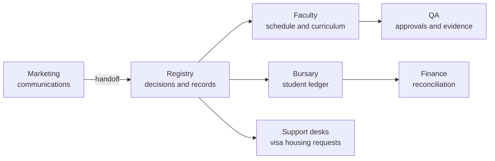

# Admin / staff CMS

## Local Academic catalogue expansion — 29 October 2026

Owner-approved Academic administration adds persistent Faculty, Programme and Modules, an independently reviewed curriculum University Flow, published catalogue choices for new applicants and exact-version student enrolments with staff-managed streams. Existing applications, student history, CMS and hosted deployments are preserved. This is local persistent Demo functionality; it does not establish a Live CMS write path. See [Academic catalogue](../ai/backend/academic-catalogue.md).

Academic tabs consistently include a visible ContentSection heading. Table tabs use the documented no-inset panel content, with a standard-inset heading above the flush AdminTable. Empty history and unconfigured-semester views use shared EmptyState. Create and Add actions include a leading Plus icon. Faculty, Programme and Module record pickers stack the code in muted label typography above the linked name; search still matches both fields. These are Staff compositions of existing released components, with no shared package or workflow change.

Academic admin record workspaces use the existing header breadcrumb and Close action, without an additional in-content breadcrumb. Record tabs, curriculum preview versions and stream filters are URL-backed. Faculty Programme links, Programme Structure links and Module Study Plan links retain campus and source-tab context through Close, header parent links, browser Back and reload. A direct Structure link returns to its owning Programme Study Plan tab. A Structure opened from Module Study Plan keeps Modules active and opens the exact published version referenced by that row; the Version column, preview label, read-only rules and summary totals identify that snapshot. Edit returns to the current working draft. Same-record view changes retain edits; owner, campus and parent navigation retain the shared unsaved-change guard. Return destinations are restricted to same-campus Academic routes, without changing server permissions.

Academic and Applicants directories omit the campus selector. Existing hosted-campus resolution, Academic URL scope, authorized-campus defaults, request cancellation and server ownership checks remain. Applicants direct-record ownership still resolves its authorized campus for the retained queue.

Academic Study Plan lists only actual main modules under Affected Modules: Staff Academic, Applicant My Applications and Student Academic. Study Plan Review appears only inside published or draft Version Details under Flow Steps, with its step number and name; the capability label and supporting description are omitted. The Versions table includes the applied current version even when its history list is empty, plus any saved draft. Create Version opens the saved draft at version=draft; Apply Version stays on the resulting published version. The Versions breadcrumb returns to the table while General edits remain mounted. Reviewer assignments remain live, immediate and access-neutral; required review and publication checks are unchanged.

Study Plan semester sections use the shared titled InnerSection and standard DataTable. The title and blue credit pill sit above an edge-to-edge divider; contained table rows and their hover background reach the section edges while cell text retains its inset. The preview identity uses SummaryCard. Semester module placements show all applicable rows without AdminTable search, sort/filter controls or pagination. Module links, stream filtering, published-version scope and Add Module/Edit Semester/placement editing remain. Directory, record-picker and Versions tables continue to use AdminTable.

Academic uses shared component-level record actions and persistent history from design-system 0.21.0. Button labels render in Title Case, with entity-specific Edit/Create actions. Existing Faculty, Programme, Module and Study Plan workspaces show a separate History panel after the active page panel, displaying recorded before/after changes through AuditTrail or EmptyState. History is absent from unsaved records and is no longer a tab. Faculty Groups administration, Faculty Short Name and Faculty Group fields/columns are removed from the Staff UI; existing stored values and group records remain intact. Faculty directories use a single AdminTable without category tabs. Programme create mode omits Study Plan/default-curriculum controls; Creative and Postgraduate fields use ordinary detail rows. Create Accreditation is a primary table-toolbar action and can save directly from a read-mode Programme with expected revision and a stable retry ID; failed saves retain the popup, while create/edit-mode accreditation remains part of the parent draft.

Study Plan Stream uses the shared top-label DropdownSelect without an InnerSection. Semester title pills show credits for the currently displayed applicable placements. DataTable rows use the shared row hover, pointer and keyboard selection for module details or placement editing. Empty review action bars are omitted; history remains independent of tab selection. Shared release adoption is limited to Staff; other portal pins are unchanged.

Shared 0.22.0 presents audit changes in labelled Field, Before and After columns, stacking them on narrow screens. Academic history expands recorded nested values and uses readable field labels; technical identity/revision/update stamps are omitted from the comparison while the recorded actor and event time remain. It never reconstructs an event from the current record. Successful catalogue, accreditation, curriculum and review actions use the shared bottom-right toast, which dismisses automatically after four seconds and pauses while hovered or focused. The toast provider survives record creation navigation. Failed saves retain their draft and existing error feedback.

Shared toast variants use success (green, the default), error (red), info (blue) and warning (amber) surfaces, borders and icons. The compact layout centers the message, icon and dismiss button without card-sized vertical padding. Academic compact-list status labels retain their component-level transparent, unpadded text treatment with the appropriate semantic colour; summary pills and directory status pills retain their existing presentation. AdminTableToolbar omits the empty actions container, preventing an extra wrapped flex row above search in narrow record lists.

Display terminology is **Study Plan** throughout Academic tabs, actions, breadcrumbs, review flow and feedback. Existing routes, flow/step IDs, API/schema keys, saved record names and recorded audit values are preserved. The built-in Academic Curriculum configuration name has a display-only Academic Study Plan alias; loading it does not change the stored name or create unsaved edits.

## Compact Admin record lists - 0.11.2

Shared AdminTable record-list entries stack their supplied fields vertically and wrap names/status badges inside the sidebar. Directory tables keep their column layout. Staff adopts this shared patch without portal CSS overrides, workflow changes or data changes.

## Admin summary scrolling - 0.11.1

Staff uses the shared full-height sticky desktop summary column. The summary/list switch stays visible while only its content scrolls, without transparent effects. Narrow layouts retain a compact panel above the form. No review controls, data or workflow behavior change.

### Admin UI preparation — 21 October 2026

The 0.10.4 visual refinement uses a larger passport photo, centered summary fields, natural-height sticky desktop scrolling/fades and standard content title sizing. Review/reload footer controls are temporarily omitted while this UI is refined. Summary/list navigation and read-only case/evidence/history remain.

Overview navigation is removed. Applicants status tabs prioritize Pending Review, followed by Approved and All; shared Badge variants color pending amber, approved/accepted green and action-required red in the directory, picker and summary. Applicants uses shared AdminTable and AdminRecordWorkspace 0.10.3 over the complete authorized campus submitted-application queue. Search, status scopes, advanced filters, sorting, 10/20/50-row pagination and campus-timezone dates remain. The Step column shows the first unfinished applicable API progress label from the pinned policy; absent progress stays unspecified. Linked rows open a read-only record with summary/virtual-list panel, original document Preview/Download, issued letters and history. API-authorized QA requests corrections or verifies eligibility and releases its letter after explicit confirmation, using the loaded revision, Demo generation and stable retry ID. Failed reviews retain the draft; shared unsaved guards protect navigation. No create/delete or applicant-field editing is offered. Campus changes reset filters and cancel outdated reads. Headers use permanent numeric SSO User ID and roles. Delivery is local, without hosted deployment or CMS changes.

## Unified Admissions review - 20 October 2026

Staff Applicants and the admissions overview now use the Portal API queue with stable case/person/campus IDs. Payments and Registrations compose the same policy-aware case review. Active Admin campus/desk permissions govern QA, Registry, Bursary, Faculty, IO and SSD actions; teaching-only roles do not gain Admin access. Evidence/messages and audit trails remain case-owned; failed/stale reviews retain drafts and safe retry identifiers. Bursary/Faculty module decisions require explicit reasons and checked clearance, followed by CAF generation. IO/SSD capabilities are available without automatically assigning staff.

The disconnected tracker inventory is historical. [University Flows](../ai/backend/university-flows.md) defines supported configuration, confirmed defaults and manual decisions. No old CMS, hosted deployment or production migration is changed by this local implementation.

**Document:** SDD-07  
**Status:** Working draft  
**Date:** 18 September 2026 (Demo menus 17 October 2026)

Demo campus Admin lives in the Staff portal at `staff.{slug}.raisd.co/admin`. Those menus appear only for `roleKey` `admin`. Access registers a student, staff member, or lecturer from the selected preset. Current rules: [docs/ai/frontend/admin-portal.md](../ai/frontend/admin-portal.md).

## 1. Purpose

Staff tools for running the campus: Registry, Faculty, Bursary/Finance, Quality Assurance, Marketing, and remaining operational desks. **Build new screens only for verified gaps.** If the old CMS already runs the workflow, the portal may deep-link or omit the screen and still mark the capability Live once verified.

## 2. Design rule ([CAP-44](11-capability-catalog.md#cap-44))

Confirm existing-CMS staff access for admissions first. A new administrator chrome is not a prerequisite for [M2](03-delivery-milestones.md#m2) if Registry can already issue offers in the old CMS.

## 3. Department map

## 4. Registry

| IDs | Milestone | Staff job |
|---|---|---|
| [CAP-03](11-capability-catalog.md#cap-03), 05, 06, 07 | [M2](03-delivery-milestones.md#m2) | Review evidence, qualification/credits, foreign equivalency, offer, first enrolment |
| [CAP-08](11-capability-catalog.md#cap-08), 09 | [M3](03-delivery-milestones.md#m3) | Student master, emergency contacts, document permissions |
| [CAP-10](11-capability-catalog.md#cap-10) | [M3](03-delivery-milestones.md#m3) | Configure and approve semester registration |
| [CAP-13](11-capability-catalog.md#cap-13) | [M3](03-delivery-milestones.md#m3) | Approve and release results |
| [CAP-16](11-capability-catalog.md#cap-16), 55 | [M3](03-delivery-milestones.md#m3) | Announce and publish policies (campus requested) |
| [CAP-15](11-capability-catalog.md#cap-15) | [M5](03-delivery-milestones.md#m5) | Graduation and official transcripts |

Rules:

- Marketing publishes recruitment copy; Registry owns formal application decisions.
- Foreign awards are never auto-equivalent ([CAP-05](11-capability-catalog.md#cap-05), 06).
- Result release is a Registry/exams action; student GPA views must not show unreleased marks.

## 5. Faculty

| IDs | Milestone | Staff job |
|---|---|---|
| [CAP-11](11-capability-catalog.md#cap-11) | [M3](03-delivery-milestones.md#m3) | Schedule classes, lecturers, rooms (campus requested) |
| [CAP-14](11-capability-catalog.md#cap-14), 23 | [M3](03-delivery-milestones.md#m3) | Study plans, prerequisites, outcomes |
| [CAP-22](11-capability-catalog.md#cap-22) | [M3](03-delivery-milestones.md#m3) | Past-paper publication rights (campus requested) |
| [CAP-24](11-capability-catalog.md#cap-24) | [M5](03-delivery-milestones.md#m5) | Exam administration and approved arrangements |

The lecturer portal is the day-to-day teaching surface; Faculty staff own the timetable grid and programme rules.

## 6. Bursary and Finance

| IDs | Milestone | Staff job |
|---|---|---|
| [CAP-45](11-capability-catalog.md#cap-45) | [M3](03-delivery-milestones.md#m3) | Invoices, balances, payment records |
| [CAP-46](11-capability-catalog.md#cap-46) | [M3](03-delivery-milestones.md#m3) | Verify bank-transfer proofs; allocate; Finance reconciles |
| [CAP-47](11-capability-catalog.md#cap-47) | [M5](03-delivery-milestones.md#m5) | Online payment reconciliation and financial documents |
| [CAP-48](11-capability-catalog.md#cap-48) | [M5](03-delivery-milestones.md#m5) | Scholarships and incentives |

Rule: a student proof ([CAP-46](11-capability-catalog.md#cap-46)) does not change the ledger until Bursary verifies it. Finance owns reconciliation and official documents; Bursary owns the student account handoff.

## 7. Quality Assurance

| IDs | Milestone | Staff job |
|---|---|---|
| [CAP-04](11-capability-catalog.md#cap-04) | [M2](03-delivery-milestones.md#m2) | Institution, programme, delivery-site approvals for intended campuses |
| [CAP-42](11-capability-catalog.md#cap-42), 43 | [M3](03-delivery-milestones.md#m3) | Copyright/provider permissions; material approval; LMS-readiness evidence |
| [CAP-30](11-capability-catalog.md#cap-30), 40 | [M5](03-delivery-milestones.md#m5) | Evaluations, confidentiality, institutional analytics |

[CAP-04](11-capability-catalog.md#cap-04) is an admissions-launch dependency: do not take applications for a programme/site that is not recorded as approved.

## 8. Marketing

[CAP-16](11-capability-catalog.md#cap-16) ([M2](03-delivery-milestones.md#m2)): publish recruitment and applicant communications. No status change on applications.

## 9. Remaining desks ([M5](03-delivery-milestones.md#m5))

| IDs | Desk |
|---|---|
| [CAP-31](11-capability-catalog.md#cap-31) | Digital library licences |
| [CAP-32](11-capability-catalog.md#cap-32) | Orientation content |
| [CAP-33](11-capability-catalog.md#cap-33) | Learner support / IT helpdesk |
| [CAP-34](11-capability-catalog.md#cap-34) | Study-centre coordination |
| [CAP-35](11-capability-catalog.md#cap-35) | Accessibility arrangements |
| [CAP-36](11-capability-catalog.md#cap-36) | Mobile staff workspace (not launch) |
| [CAP-49](11-capability-catalog.md#cap-49) | Career / portfolio guidance |
| [CAP-50](11-capability-catalog.md#cap-50) | Immigration / visa cases |
| [CAP-51](11-capability-catalog.md#cap-51) | Requests, complaints, appeals |
| [CAP-52](11-capability-catalog.md#cap-52) | Accommodation allocation |
| [CAP-54](11-capability-catalog.md#cap-54) | Campus services information |

## 10. Current baseline

No staff application. Suggested next-action roles in BASE-* rows are hints, not named owners. Every staff row is Not started except [CAP-36](11-capability-catalog.md#cap-36) Not applicable.

## 11. Acceptance

- [M2](03-delivery-milestones.md#m2): Registry can complete application-to-enrolment on verified old CMS or new screens; [CAP-04](11-capability-catalog.md#cap-04) evidence collected for Cyberjaya programmes.
- [M3](03-delivery-milestones.md#m3): Registration, result release, billing verification, timetable administration, and content approval each have a named Live path.
- Do not open a parallel staff UI that double-enters data the old CMS already holds.

## Configured admissions pending action — 22 October 2026

Admin and Applicant use the same Control-owned current action: **Awaiting Applicant Confirmation** after Eligibility release, with **Confirm Eligibility · Applicant** next. Confirmation advances to **Awaiting Bursary Review / Registration Fee**. Completed progress/history retains **Eligibility Letter Released**. Queue scopes, table and summary use the current pending action and shared semantic Badge tones. Viewing a projection never advances the case.

## Predefined Admissions Flow Editor (local implementation, 28 October 2026)

Control configures predefined workflow template 1 in immutable versions, independently for Local/International students. Shared 0.19.0 owns linked/reorderable step presentation; Portal API owns pinned evaluation and financial/document invariants; SSO owns immediate audited campus-role reviewer bindings. Published history and existing accepted cases remain unchanged. The implementation includes guarded drafts, role coverage, quote/fixed pricing and structured text letters with synthetic previews. It does not introduce arbitrary workflow scripting or grant access through assignment. Hosted activation remains separate. Normative details: [Flow Editor](../ai/design/flow-editor.md).
